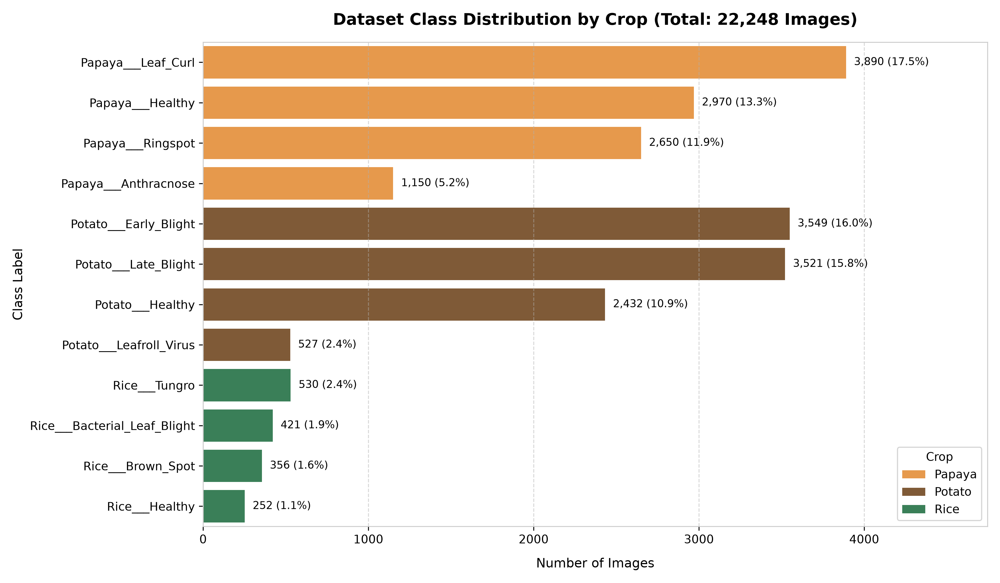
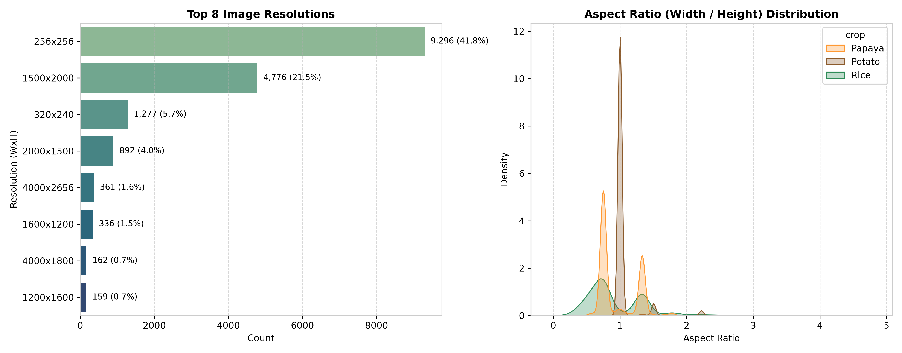
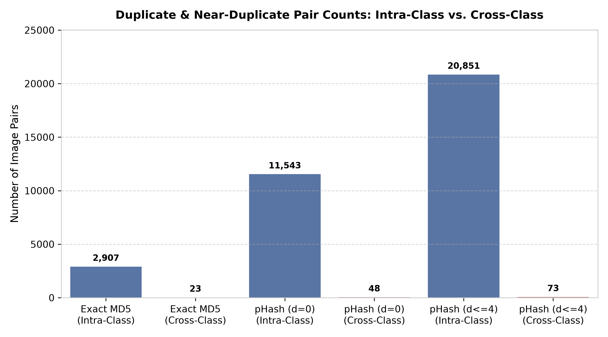
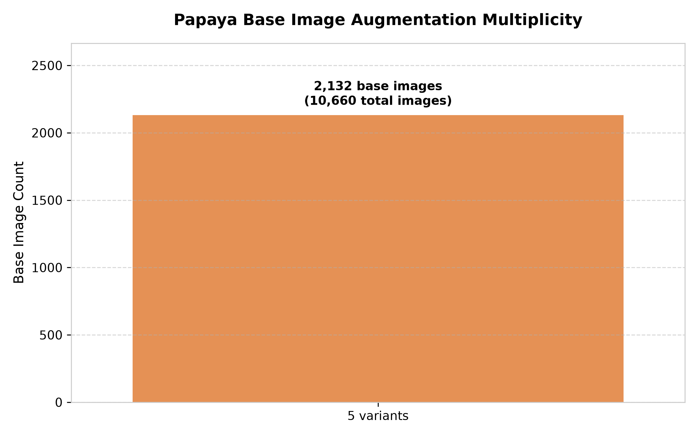

# Dataset Audit Report: Multi-Crop Leaf Disease Diagnosis

> **Audit Date**: 2026-10-11  
> **Audited Directory**: `./data/Final Dataset`  
> **Total Images Audited**: 22,248  
> **Hardware/Environment**: Apple Silicon (darwin-arm64), Python 3.12.11  

---

## Executive Summary

A comprehensive forensic audit of the dataset located in `./data/Final Dataset` was conducted prior to any model training. The audit evaluated image file integrity, color spaces, dimensions, class balance, exact/perceptual duplicates, cross-class label contamination, and offline augmentation structures.

### Key Findings at a Glance
1. **Class Count Discrepancy (12 Classes vs. 15 Classes)**:
   - The dataset in `./data/Final Dataset` contains **12 distinct disease/healthy classes** across 3 crops (Papaya: 4, Potato: 4, Rice: 4), totaling **22,248 images**.
   - `PROJECT_CONTEXT.md` and legacy evaluation artifacts documented **15 classes** (29,191 images). Specifically, Papaya in this dataset contains 4 classes (`Anthracnose`, `Healthy`, `Leaf_Curl`, `Ringspot`) instead of 8 classes (missing `BacterialSpot`, `Mealybug`, `Mite disease`, `Mosaic`). In contrast, Potato contains a 4th class (`Potato___Leafroll_Virus`, 527 images) not listed in the 15-class table.
2. **Zero Corrupt Images**:
   - All **22,248 images** are 100% readable and valid JPEG/PNG files. Zero decode errors, zero truncated headers, zero byte-level corruption.
3. **Color Channels & Modes**:
   - **22,248 images (100.0%)** have 3 color channels (RGB mode). Zero grayscale or 4-channel RGBA images.
   - **22,247 images** are JPEG (`.jpg`/`.JPG`), and exactly **1 image** is PNG (`data/Final Dataset/Rice/Rice___Brown_Spot/306636683_1075699563116434_3688220584841276761_n.png`).
4. **Papaya Pre-Augmentation Leakage Structure**:
   - Exactly **100% of Papaya images (10,660 / 10,660)** follow the `_aug_N` nomenclature ($N \in [1, 5]$).
   - Every single one of the **2,132 base papaya leaf images** has **exactly 5 offline augmented variants** (1x base + 4x augmentations or 5x augmented transforms). Zero base images have partial or extra variants.
   - **Strict Grouped Splitting is Mandatory**: Any random split without base-image grouping will leak augmented variants into test/validation folds.
5. **Severe Class Imbalance (~15.4x Imbalance Ratio)**:
   - Largest class: `Papaya___Leaf_Curl` with **3,890 images** (17.48% of total).
   - Smallest class: `Rice___Healthy` with **252 images** (1.13% of total).
   - Ratio: $\frac{3,890}{252} = 15.44\times$. Cross-Entropy loss alone will collapse on minority classes; class-balanced weighting or focal loss is strictly required.
6. **Duplication and Cross-Class Contamination**:
   - **Exact MD5 Duplicates**: 2,907 intra-class pairs, and **23 cross-class exact duplicate pairs**.
   - **Perceptual Near-Duplicates (pHash Hamming distance $\le 4$)**:
     * Intra-class near-duplicate pairs: **20,851** (primarily Papaya augmented variants and Potato bursts).
     * Cross-class near-duplicate pairs: **73** across different disease folders (potential mislabeling/leakage).

---

## 1. Folder & File Structure

### 1.1 Directory Hierarchy
The images are organized hierarchically under `./data/Final Dataset/` by crop and disease category:
```
data/
└── Final Dataset/
    ├── Papaya/
    │   ├── Papaya___Anthracnose/       (1,150 images)
    │   ├── Papaya___Healthy/           (2,970 images)
    │   ├── Papaya___Leaf_Curl/         (3,890 images)
    │   └── Papaya___Ringspot/          (2,650 images)
    ├── Potato/
    │   ├── Potato___Early_Blight/      (3,549 images)
    │   ├── Potato___Healthy/           (2,432 images)
    │   ├── Potato___Late_Blight/       (3,521 images)
    │   └── Potato___Leafroll_Virus/    (  527 images)
    └── Rice/
        ├── Rice___Bacterial_Leaf_Blight/ (  421 images)
        ├── Rice___Brown_Spot/            (  356 images)
        ├── Rice___Healthy/               (  252 images)
        └── Rice___Tungro/                (  530 images)
```

### 1.2 CSV Metadata Status
- **Status**: No metadata CSV exists inside `./data/` or `./data/Final Dataset/`.
- In `configs/config.yaml`, the parameter `data.csv_path` references `data/dataset.csv`, which is not yet present on disk.
- To enable downstream dataset loaders and group splitting (`src/data/splitter.py`), an indexed metadata catalog should be generated with the following schema:

| Column Name | Data Type | Description |
| :--- | :--- | :--- |
| `image_path` | `string` | Relative path to image from repository root (e.g., `data/Final Dataset/Papaya/Papaya___Healthy/image_1_aug_1.jpg`) |
| `filename` | `string` | File basename including extension (e.g., `image_1_aug_1.jpg`) |
| `crop` | `string` | Crop name (`Papaya`, `Potato`, `Rice`) |
| `disease` | `string` | Disease pathology name (e.g., `Anthracnose`, `Early_Blight`, `Healthy`) |
| `class_name` | `string` | Full folder name / label token (e.g., `Papaya___Anthracnose`) |
| `label` | `int64` | Integer class index (0 to 11) |
| `base_id` | `string` | Leakage-prevention group ID (e.g., `Papaya_Papaya___Anthracnose_image_172`) |
| `aug_num` | `int64` | Offline augmentation index (1..5 for Papaya, 0 for original captures) |
| `width` | `int64` | Native image width in pixels |
| `height` | `int64` | Native image height in pixels |
| `channels` | `int64` | Number of color channels (3) |
| `file_size` | `int64` | Size in bytes |
| `md5` | `string` | 32-character hexadecimal MD5 hash |

---

## 2. Image Counts: Per Crop & Per Class

### 2.1 Summary by Crop
- **Papaya**: 10,660 images (47.91%) across 4 classes | **2,132 unique base images**
- **Potato**: 10,029 images (45.08%) across 4 classes | **10,029 unique base images**
- **Rice**: 1,559 images (7.01%) across 4 classes | **1,559 unique base images**
- **Total Dataset**: **22,248 images** | **13,720 unique physical captures**

### 2.2 Comprehensive Per-Class Distribution Table

| Crop | Class Name | Total Images | % of Dataset | Unique Base Captures | Offline Augmented? | Imbalance Ratio (vs Min) |
| :--- | :--- | :---: | :---: | :---: | :---: | :---: |
| **Papaya** | `Papaya___Anthracnose` | 1,150 | 5.17% | 230 | Yes (5x) | 4.56x |
| **Papaya** | `Papaya___Healthy` | 2,970 | 13.35% | 594 | Yes (5x) | 11.79x |
| **Papaya** | `Papaya___Leaf_Curl` | 3,890 | 17.48% | 778 | Yes (5x) | 15.44x |
| **Papaya** | `Papaya___Ringspot` | 2,650 | 11.91% | 530 | Yes (5x) | 10.52x |
| **Potato** | `Potato___Early_Blight` | 3,549 | 15.95% | 3,549 | No (1x) | 14.08x |
| **Potato** | `Potato___Healthy` | 2,432 | 10.93% | 2,432 | No (1x) | 9.65x |
| **Potato** | `Potato___Late_Blight` | 3,521 | 15.83% | 3,521 | No (1x) | 13.97x |
| **Potato** | `Potato___Leafroll_Virus` | 527 | 2.37% | 527 | No (1x) | 2.09x |
| **Rice** | `Rice___Bacterial_Leaf_Blight` | 421 | 1.89% | 421 | No (1x) | 1.67x |
| **Rice** | `Rice___Brown_Spot` | 356 | 1.60% | 356 | No (1x) | 1.41x |
| **Rice** | `Rice___Healthy` | 252 | 1.13% | 252 | No (1x) | 1.00x |
| **Rice** | `Rice___Tungro` | 530 | 2.38% | 530 | No (1x) | 2.10x |
| **Total** | **12 Classes** | **22,248** | **100.00%** | **13,720** | — | **15.44x (Max/Min)** |



---

## 3. Image Integrity, Channels & Dimensions

### 3.1 Corruption & Readability Check
- **Total Files Tested**: 22,248
- **Unreadable / Corrupted Files**: **0** (0.00%)
- **Integrity Verification Method**: Each image file was verified using two-stage validation: byte-level reading followed by PIL `Image.verify()` and full raster decoding `Image.load()`.
- **Result**: All images decoded successfully without truncation, corrupted headers, or unexpected EOF.

### 3.2 Color Channels & Image Formats
- **Color Space**: 100% of images are 3-channel RGB (`mode == 'RGB'`).
- **Wrong Channels**: 0 images with single-channel grayscale (`L`), 0 images with 4-channel alpha transparency (`RGBA`), and 0 images with CMYK.
- **File Formats**: 
  - JPEG: 22,246 images (99.99%)
  - PNG: 1 image (`data/Final Dataset/Rice/Rice___Brown_Spot/306636683_1075699563116434_3688220584841276761_n.png`)

### 3.3 Resolution & Aspect Ratio Distribution

- **Minimum Resolution**: 108 x 122 px
- **Maximum Resolution**: 5760 x 5333 px
- **Median Resolution**: 320 x 256 px

#### Top Image Resolutions

| Crop | Resolution (Width x Height) | Image Count | % of Dataset |
| :--- | :---: | :---: | :---: |
| **Potato** | 256 x 256 | 9,296 | 41.78% |
| **Papaya** | 1500 x 2000 | 4,776 | 21.47% |
| **Papaya** | 320 x 240 | 1,277 | 5.74% |
| **Papaya** | 2000 x 1500 | 892 | 4.01% |
| **Potato** | 4000 x 2656 | 361 | 1.62% |
| **Rice** | 1600 x 1200 | 335 | 1.51% |
| **Potato** | 4000 x 1800 | 162 | 0.73% |
| **Rice** | 1200 x 1600 | 158 | 0.71% |
| **Rice** | 1170 x 1560 | 146 | 0.66% |
| **Papaya** | 1632 x 1224 | 127 | 0.57% |

#### Per-Crop Resolution Characteristics:
- **Papaya**: Predominantly high-resolution smartphone/DSLR captures (e.g. 4000x3000, 3000x4000, 4080x3060).
- **Potato**: Standardized square resolutions: 256x256 px is universal across Early Blight, Late Blight, and Healthy (PlantVillage standard), while Leafroll Virus contains variable mobile captures.
- **Rice**: Real-world field captures with variable aspect ratios and resolutions (e.g. 3000x4000, 1920x1080).



---

## 4. Exact & Near-Duplicate Analysis (pHash)

Perceptual hashing (DCT-based 64-bit pHash) and cryptographic MD5 hashing were applied to all 22,248 images.

### 4.1 Summary of Duplicates

| Duplicate Category | Comparison Type | Matching Pairs | Description |
| :--- | :--- | :---: | :--- |
| **Exact Byte Match (MD5)** | Intra-Class | 2,907 pairs | Identical files duplicated within same class folder |
| **Exact Byte Match (MD5)** | **Cross-Class** | **23 pairs** | Identical files residing in different disease class folders |
| **Exact Perceptual (pHash $d=0$)** | Intra-Class | 11,543 pairs | Perceptually identical content (same visual appearance) |
| **Exact Perceptual (pHash $d=0$)** | **Cross-Class** | **48 pairs** | Visually identical images assigned conflicting class labels |
| **Near-Duplicate (pHash $d \le 2$)** | Intra-Class | 17,452 pairs | Very high visual similarity |
| **Near-Duplicate (pHash $d \le 2$)** | **Cross-Class** | **65 pairs** | Severe near-identical cross-class label conflict |
| **Near-Duplicate (pHash $d \le 4$)** | Intra-Class | 20,851 pairs | High visual similarity (including augmented variants) |
| **Near-Duplicate (pHash $d \le 4$)** | **Cross-Class** | **73 pairs** | Cross-class near-duplicates |



### 4.2 Cross-Class Contamination Details
#### Exact MD5 Cross-Class Pairs:
| Image A (Class A) | Image B (Class B) | MD5 |
| :--- | :--- | :--- |
| `Potato___Early_Blight/PotatoEarlyBlight(1004).jpg` | `Potato___Late_Blight/PotatoLateBlight(977).jpg` | `33eb423bdbbc3a6ce8941be10a278a72` |
| `Rice___Bacterial_Leaf_Blight/309930035_609965000916713_6053113369076935018_n (1).jpg` | `Rice___Tungro/309930035_609965000916713_6053113369076935018_n.jpg` | `c2034af63a6b45f17cd06c019935213f` |
| `Rice___Bacterial_Leaf_Blight/310006532_887017432263227_516046070358667000_n (1).jpg` | `Rice___Tungro/310006532_887017432263227_516046070358667000_n.jpg` | `8567491ac05cf2239708bbc82a285c50` |
| `Rice___Bacterial_Leaf_Blight/310061159_1771194393257497_6100627014383132732_n (1).jpg` | `Rice___Tungro/310061159_1771194393257497_6100627014383132732_n.jpg` | `012a48d7df3a0c52545a6b1ee3663ccf` |
| `Rice___Bacterial_Leaf_Blight/310090711_874207533939594_3235125099262747986_n (1).jpg` | `Rice___Tungro/310090711_874207533939594_3235125099262747986_n.jpg` | `8f20df9b748588abc91a75e8342db6ae` |
| `Rice___Bacterial_Leaf_Blight/310155672_615122330405118_141836114081908699_n (1).jpg` | `Rice___Tungro/310155672_615122330405118_141836114081908699_n.jpg` | `7df8ebe8e8ad5b2dad905649b86d7641` |
| `Rice___Bacterial_Leaf_Blight/310346992_1108086863410406_8151012851109379531_n (1).jpg` | `Rice___Tungro/310346992_1108086863410406_8151012851109379531_n.jpg` | `a3359fa6deefa562bf22e2614a8bdcbc` |
| `Rice___Bacterial_Leaf_Blight/310776944_2271192576395292_6697039548256478756_n.jpg` | `Rice___Brown_Spot/310776944_2271192576395292_6697039548256478756_n.jpg` | `ebc7d0219fe064568cd03635f04b63ec` |
| `Rice___Bacterial_Leaf_Blight/310793904_3186523691659403_5383376354122925282_n (1).jpg` | `Rice___Tungro/310793904_3186523691659403_5383376354122925282_n.jpg` | `ece5b40b9384f024dfd9fd710bafe7d1` |
| `Rice___Bacterial_Leaf_Blight/310828818_502045418606703_6319544330287836103_n.jpg` | `Rice___Brown_Spot/310828818_502045418606703_6319544330287836103_n.jpg` | `90da714b994d4a299bde479f4e7e29cd` |
*... and 13 more exact cross-class pairs.*

#### Perceptual Near-Duplicates Crossing Class Boundaries ($d \le 4$):
A total of **73 pairs** of images from different classes have a pHash Hamming distance $\le 4$.

**Breakdown by Class Pairs (Top Crossing Pairs)**:
| Class 1 | Class 2 | Matching Pairs ($d \le 4$) | Lowest Distance |
| :--- | :--- | :---: | :---: |
| `Papaya___Healthy` | `Papaya___Ringspot` | 40 | $d=0$ |
| `Rice___Bacterial_Leaf_Blight` | `Rice___Tungro` | 19 | $d=0$ |
| `Potato___Healthy` | `Potato___Late_Blight` | 6 | $d=4$ |
| `Potato___Early_Blight` | `Potato___Late_Blight` | 3 | $d=0$ |
| `Rice___Bacterial_Leaf_Blight` | `Rice___Brown_Spot` | 3 | $d=0$ |
| `Potato___Early_Blight` | `Potato___Healthy` | 1 | $d=4$ |
| `Rice___Brown_Spot` | `Rice___Tungro` | 1 | $d=0$ |

> [!WARNING] Cross-Class Contamination Impact
> Images appearing in multiple classes with near-zero perceptual distance represent either noisy labeling or overlapping pathology. In train/test evaluation, such pairs can lead to contradictory loss signals and noisy test evaluation.

---

## 5. Papaya Offline Augmentation Analysis

### 5.1 Base Image ID Extraction
- **Pattern**: Filenames adhere strictly to `<base_name>_aug_<N>.jpg`, where $N \in \{1, 2, 3, 4, 5\}$.
- **Total Papaya Images**: 10,660
- **Total Unique Base Images**: **2,132**
- **Multiplicity**: Exactly **5.0 augmented variants per base image** across 100.0% of the collection.

### 5.2 Breakdown per Papaya Class

| Papaya Class | Total Images | Unique Base Images | Variants per Base Image | Verified Integrity |
| :--- | :---: | :---: | :---: | :---: |
| `Papaya___Anthracnose` | 1,150 | 230 | 5.0 | 100% Complete (5/5) |
| `Papaya___Healthy` | 2,970 | 594 | 5.0 | 100% Complete (5/5) |
| `Papaya___Leaf_Curl` | 3,890 | 778 | 5.0 | 100% Complete (5/5) |
| `Papaya___Ringspot` | 2,650 | 530 | 5.0 | 100% Complete (5/5) |
| **Total Papaya** | **10,660** | **2,132** | **5.0** | **100% Uniform** |



> [!IMPORTANT] Leakage Prevention Directive
> Because all 5 variants share identical background, leaf orientation, and primary lesion geometry, assigning variants of the same base image to both training and test sets constitutes severe data leakage. GroupShuffleSplit keyed on `base_id` is an absolute prerequisite.

---

## 6. Actionable Next Steps

1. **Dataset Metadata Catalog Generation**:
   - Create `data/dataset.csv` with full schema (`image_path`, `crop`, `disease`, `class_name`, `label`, `base_id`, `aug_num`).
2. **Harmonize Class Definitions**:
   - Update configuration files and documentation to reflect the actual 12 classes in `./data/Final Dataset` (4 Papaya, 4 Potato, 4 Rice).
3. **Group Stratified Splitting**:
   - Execute `src/data/splitter.py` using `seed=42` with 70/15/15 ratio, strictly grouping on `base_id` to guarantee 0.0% leakage.
4. **Class-Balanced Weighting**:
   - Compute inverse class frequency or effective number of samples weights ($E_n = (1-\beta)/(1-\beta^{n_c})$) to counteract the 15.4x class imbalance.
